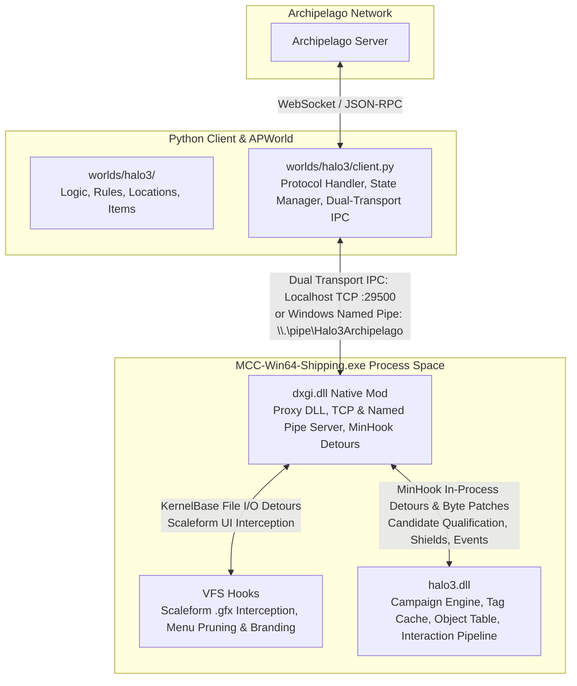
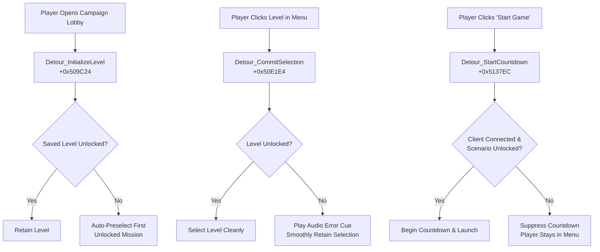
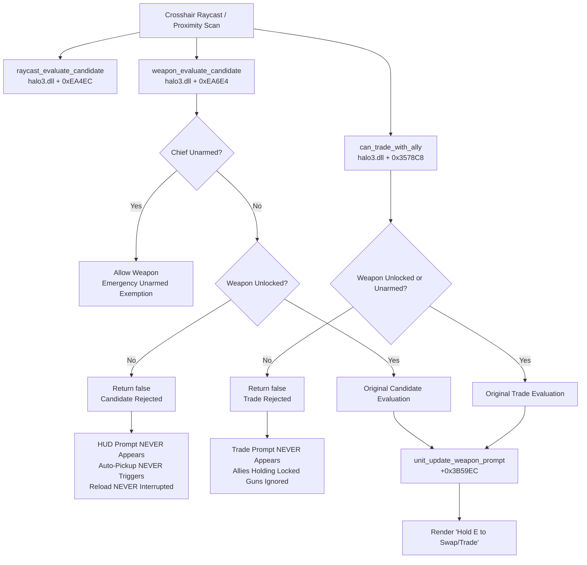

# Halo 3 Archipelago Architecture & IPC Protocol

This document provides a comprehensive technical overview of the architecture
connecting the **Archipelago MultiWorld** ecosystem to **Halo 3** running inside
_Halo: The Master Chief Collection_ (MCC).

---

## 1. System Overview

The integration spans three core components communicating across process and
network boundaries:



### Component Roles

1. **Archipelago World Definition (`worlds/halo3/`)**:
   - Implements `Halo3World(World)` for seed generation.
   - Defines items (Mission Unlocks, Weapon Licenses, Shield Upgrades, Traps),
     locations (Mission Completions, Collectibles, Rally Points), YAML options,
     and progression logic graphs.

2. **Archipelago Client (`worlds/halo3/client.py`)**:
   - Connects to the Archipelago server via WebSockets (`CommonContext`).
     Registered as `"Halo 3 Client"` in `worlds/halo3/components.py`.
   - Receives items, tracks received item indices, and reconciles state upon
     reconnection.
   - Pushes live inventory, weapon licensing, and shield progression state to
     the native mod over a dual-transport IPC connection.
   - Consumes live in-game events (skulls, terminals, rally points, mission
     completions) reported by the native mod to dispatch location checks
     automatically.

3. **Native MCC Mod (`mcc_mod/dxgi.dll`)**:
   - Loads into `MCC-Win64-Shipping.exe` at startup via DXGI proxying.
   - Runs concurrent Localhost TCP (`127.0.0.1:29500`) and Windows Named Pipe
     (`\\.\pipe\Halo3Archipelago`) IPC servers.
   - Intercepts MCC file loading (VFS hooks) to prune irrelevant menus, brand
     the interface for Archipelago, and skip intermediate submenus to jump
     straight to mission selection.
   - Hooks campaign lobby functions to enforce mission locks interactively
     (retaining unlocked selections with audio feedback, preselecting available
     levels, and blocking countdowns).
   - Dynamically discovers `halo3.dll` when campaign missions load and detours
     Halo 3's native interaction qualification pipeline for real-time weapon
     licensing, ally trade gating, progressive shields, and event detection.
   - **Module structure:**
     - `hook_manager.cpp` — Slim orchestrator with data-driven hook table,
       signature pattern scanning, and fallback management.
     - `pattern_scan.h` / `pattern_scan.cpp` — Dynamic byte signature scanning
       (`FindPatternInModule`) across module sections, resolving functions and
       global structures with automatic RVA fallback.
     - `engine/tag_system.cpp` — Tag instance resolution, O(1) weapon
       identification via Set 0xE StringIDs, dynamic tag scanning.
     - `engine/object_table.cpp` — Object datum resolution via TLS, player
       identification, inventory enforcement, progressive shield scaling.
     - `hooks/menu_hooks.cpp` — Scaleform mission carousel filtering
       (`UIWidgetArray::AddItem` at `+0x895F54`), dynamically omitting locked
       mission cards so only unlocked levels populate the campaign carousel.
     - `hooks/shell_command.cpp` — Engine-level `ShellCommand` detour
       (`IGameEngine` vtable slot 3) resolving `CreateGameEngine` to dispatch
       clean teardown sequences upon mission completion.
     - `hooks/vfs_hooks.cpp` — Virtual File System redirection
       (`CreateFileW`/`A`, `ReadFile`, `GetOverlappedResult`,
       `CreateFileMappingW`, `MapViewOfFile`) for Scaleform UI (`.gfx`) screens,
       menu restructuring, and in-flight scenario map skull placement flag patching.
     - `hooks/lobby_hooks.cpp` — MCC CampaignLobby interception
       (`StartCountdown`, `CommitSelection`, `InitializeLevel`,
       `RestartGameEngine`).
     - `hooks/weapon_hooks.cpp` — All weapon interaction detours (candidate
       evaluation, prompt suppression, pickup/swap/trade gating, unarmed
       emergency exemption).
     - `hooks/engine_hooks.cpp` — Halo 3 simulation tick, MCC engine dispatch,
       and audio loop control hooks.
     - `hooks/event_hooks.cpp` — Rally point, terminal, skull, and victory
       detection hooks. Fires events consumed by the client via IPC.
     - `pipe_server.cpp` — Concurrent Localhost TCP (`:29500`) and Windows Named
       Pipe IPC servers.
     - `memory_utils.h` — Shared `IsValidRead` pointer validation,
       `FindFunctionByStringXref` dynamic function discovery, and
       `LOG_ONCE_PER_DATUM` macro.
     - `offsets.h` — Centralized memory address and struct offset registry.

---

## 2. Dual-Transport IPC Protocol

State synchronization between `worlds/halo3/client.py` and `dxgi.dll` supports
**Dual-Transport IPC**:

1. **Localhost TCP Socket** (`127.0.0.1:29500`): Primary universal transport
   defined in `worlds/halo3/constants.py`. Works out-of-the-box across Windows,
   Linux (Wine/Proton), and Steam Deck without OS-specific IPC boundaries.
2. **Windows Named Pipe** (`\\.\pipe\Halo3Archipelago`): Native Windows
   fallback.
3. **Transport Framing**: Full-duplex byte stream, text-mode UTF-8,
   newline-delimited JSON (`\n`).
4. **Thread Safety**: State writes and reads in `dxgi.dll` are protected by
   `std::mutex` (`g_modState.mtx`) and `std::atomic` fields.

### Handshake Greeting

Upon establishing a connection, the native mod immediately sends a greeting
line:

```json
{ "event": "mod_connected", "version": "1.0.0" }
```

---

### Protocol Specification: Continuous State Sync & Event Delivery

To ensure zero latency for in-game event detection and state propagation,
`worlds/halo3/client.py` synchronizes state at 500ms intervals inside
`mcc_watcher`:

- **Direction**: Client &harr; Native Mod
- **Client Request**:
  ```json
  {
    "unlocked_missions": ["Sierra 117", "Crow's Nest"],
    "unlocked_weapons": ["assault_rifle", "battle_rifle"],
    "weapon_license_mode": 1,
    "starting_weapon": "assault_rifle",
    "max_shield_fraction": 1.5,
    "deathlink_pending": "kill"
  }
  ```
  _(Parameters: `weapon_license_mode`: `0` = Vanilla/Disabled, `1` = Individual,
  `2` = Tiers; `max_shield_fraction`: float multiplier e.g. `0.0` = Glass
  Cannon, `1.0` = Vanilla, `2.0` = 200% Overshield; `deathlink_pending`:
  optional penalty `"kill"`, `"shield_break"`, or `"mortal"`)_
- **Native Mod Response**:
  ```json
  {
    "status": "ok",
    "events": [
      "rally_1:010_jungle",
      "skull_secondary_0:010_jungle",
      "game_won:010_jungle",
      "player_death"
    ]
  }
  ```
  _(Pending events are drained atomically from `g_modState.pendingEvents` upon
  receipt of the request)._

> [!NOTE] All live state synchronization occurs via this continuous JSON
> payload. Standalone `cmd`-based requests from early design drafts are
> consolidated into this single bidirectional sync loop.

---

## 3. MCC Menu Navigation, VFS Interception & Lobby Gating

To provide a seamless, console-like randomizer experience, `dxgi.dll` overhauls
MCC's frontend navigation:

### 1. Scaleform UI Interception (VFS Hooks)

- `dxgi.dll` installs MinHook detours on Win32 file I/O APIs
  (`KernelBase!CreateFileW`, `CreateFileA`, `ReadFile`, `GetOverlappedResult`,
  `CreateFileMappingW`, `MapViewOfFile`).
- Intercepts requests for MCC's Scaleform flash screens (`.gfx`):
  - **Main Menu Streamlining**: Prunes irrelevant modes (Multiplayer, Firefight,
    Forge, Theater) and brands the front-end for Archipelago.
  - **Fast Navigation**: Selecting Campaign launches directly into Halo 3's
    mission select screen, bypassing intermediate "Built-In vs Mods" and
    playlist selection dialogs.

### 2. Campaign Lobby Gating Lifecycle

To prevent desynchronization or accidental loading into locked missions:



1. **Auto-Preselection (`Detour_InitializeLevel` at `+0x509C24`)**:
   - If MCC's save data had a locked mission selected, the lobby automatically
     defaults to the player's first available unlocked mission
     (`GetFirstUnlockedMissionIndex()`).
2. **Interactive Selection Gating (`Detour_CommitSelection` at `+0x50E1E4`)**:
   - Clicking a locked mission in the menu plays an immediate audio error cue
     and smoothly retains the currently selected unlocked mission.
3. **Countdown Guard (`Detour_StartCountdown` at `+0x5137EC`)**:
   - Intercepts the countdown trigger. Verifies the chapter token (e.g.
     `$H3_Chapter_3-1_Title` &rarr; `010_jungle` &rarr; `Sierra 117`) against
     `unlockedMissions`.
   - If locked or if the client is disconnected (`!IsClientConnected()`),
     suppresses the countdown entirely.
4. **Session Integrity**:
   - Unlocks are tied strictly to active Archipelago connection state,
     protecting players from launching campaigns while desynced or disconnected.

### 3. Scaleform Carousel Widget Filtering (`hooks/menu_hooks.cpp`)

To present only accessible campaign missions directly within MCC's campaign UI:
- `dxgi.dll` intercepts `UIWidgetArray::AddItem` (RVA `+0x895F54`) via dynamic byte signature scanning with static RVA fallback.
- When MCC populates the horizontal campaign mission selection carousel, `AddItem` is called for each candidate level item.
- The detour verifies the item vtable and index getter to ensure it belongs to Halo 3.
- It checks the mission scenario against `g_modState.unlockedMissions`. If locked, `DetourAddItem` returns `false` without appending the card to the UI carousel array.
- This dynamically presents only currently unlocked missions to the player, while leaving other campaign selection flows (such as Halo 2 or Reach) completely stable and unaffected.

---

## 4. Halo 3 In-Engine Interaction Pipeline & Weapon Gating

Halo 3's weapon gating intercepts the **native qualification phase** of the
interaction pipeline inside `halo3.dll`.



### Emergency Unarmed Exemption

To eliminate softlocks on levels where the player begins without weapons (such
as Crow's Nest) or after empty-handed drops:

- `UnitHasAnyWeapon` and `ChiefHasAnyWeapon` inspect the player's 4 inventory
  slots (`unitObj + 0x268`).
- If the player is completely unarmed, candidate rejection is bypassed across
  `Detour_WeaponEvaluateCandidate`, `Detour_CanTradeWithAlly`,
  `Detour_unit_can_pickup_weapon`, `Detour_unit_update_weapon_prompt`,
  `Detour_unit_action_pickup_weapon`, and `Detour_unit_add_weapon`, allowing
  Chief to acquire an initial emergency weapon.

---

## 5. Dynamic Shield Progression & Audio Management

Archipelago introduces configurable **MJOLNIR Shield Progression** managed via
`g_maxShieldFraction`:

- **Glass Cannon Mode (`0.0`)**: Shields are locked at 0 vitality; player must
  survive entirely on base health.
- **Progressive Shields (`< 1.0`)**: Caps shield recharge at fractional capacity
  (e.g. 25%, 50%, 75%).
- **Vanilla Shields (`1.0`)**: Standard 100% capacity.
- **Overshield Modes (`> 1.0` up to `3.0`)**: Allows shields to recharge beyond
  100% (e.g. 150%, 200%, 300%).

### Shield Engine Detours

1. **Vitality Enforcement (`EnforcePlayerShields` in
   `engine/object_table.cpp`)**:
   - Executed on every simulation tick (`Halo3EngineStep`).
   - Clamps shield vitality to `g_maxShieldFraction`.
   - For overshields (> 100%), after vanilla recharge completes (1.0) and a
     5-second damage cooldown expires, progressively recharges shield vitality
     up to `maxFrac`.
2. **Overshield Decay Bypass Patch (`halo3.dll + 0x36E5FA`)**:
   - Patches `jbe +0x74` (`76 74`) to `jmp +0x74` (`EB 74`).
   - Bypasses the campaign engine's hardcoded timer that automatically decays
     shields above 1.5x down to 1.0x, allowing permanent overshields up to 3.0x.
3. **Recharge Audio Silencer (`Detour_UnitUpdateSound` at
   `halo3.dll + 0x1EC3C`)**:
   - When shields are capped below 100% (< 1.0), Halo 3's engine continues
     attempting to recharge shields, leaving the shield recharge sound loop
     active indefinitely.
   - `Detour_UnitUpdateSound` intercepts unit sound updates for units with
     `soundFlags & 0x80`. When Chief's shields reach `maxFrac`, it clears unit
     flag bit 10 (`0x400` on `chiefObj + 0x110`), cleanly silencing the looping
     audio bug.

### DeathLink Architecture & Execution

1. **Vitality Offsets**:
   - `H3_UNIT_HEALTH` (`+0xF4`): Current unit health float (`1.0f` = full, `<= 0.001f` = dead).
   - `H3_UNIT_SHIELD` (`+0xF8`): Current unit shield vitality float (`1.0f` = full, `0.0f` = depleted).
   - `H3_UNIT_RECHARGE_DELAY` (`+0x10C`): 16-bit shield recharge delay timer. Setting to `0` triggers immediate shield recharge.
2. **Spawn Grace Period (`s_spawnGraceTicks = 180`)**:
   - On map load or player datum change, a ~6 second debounce is engaged.
   - During this period, map loading, scripting, and camera fade-in complete without interference.
   - DeathLink penalties received while in menus or loading screens are preserved in `g_pendingDeathLinkEffect` and deferred until Chief has completed spawning, acquired his loadout (`ChiefHasAnyWeapon`), and confirmed vitality (`health > 0.50f`), preventing engine hangs on black loading screens.
3. **Double Feedback Loop Suppression**:
   - When an incoming DeathLink executes `kill`, `s_wasChiefAlive` is immediately set to `false` and a 300-tick (~10s) cooldown is asserted in C++. In Python, `is_penalty_death_pending` catches and consumes the event. This guarantees incoming deathlink penalties are never echoed back out to Archipelago as natural local deaths.

---

## 6. Universal O(1) Tag Identification (Set 0xE StringIDs)

Tag indices vary across campaign maps, but Halo 3 compiles a **Switch-To
StringID** into every weapon tag definition at offset `+0x11C`. These StringIDs
belong to **Set 0xE** (global engine strings compiled into `halo3.dll`) and are
**100% constant across every map**.

Resolved via
[GetWeaponNameFromS11C](file:///c:/Users/Jonathan/Projects/Code/Archipelago/Archipelago/mcc_mod/engine/tag_system.cpp#L50-L77)
in `engine/tag_system.cpp`:

```
Tag Datum (0x????xxxx)
  │
  ├──> Index = datum & 0xFFFF
  ├──> halo3.dll + 0xA49018 (tag_instances) + index * 8 + 4  ──> tagOffsetDword
  └──> halo3.dll + 0x1FCF4C8 (tag_cache_base) + tagOffsetDword * 4  ──> tagDef Address
                                                                          │
                                                                   tagDef + 0x11C (s11c)
                                                                          │
                                                                          ▼
                                                         Switch-To StringID (Set 0xE)
```

### Verified Set 0xE Switch-To StringID Table (`tag_system.cpp:51-76`)

| StringID (`s11c`) | Canonical Weapon Key | Weapon Name / Description                                      |
| :---------------- | :------------------- | :------------------------------------------------------------- |
| `0xE112`          | `assault_rifle`      | MA5C Individual Combat Weapon System                           |
| `0xE114`          | `battle_rifle`       | BR55HB Service Rifle                                           |
| `0xE116`          | `brute_shot`         | Type-25 Grenade Launcher                                       |
| `0xE117`          | `covenant_carbine`   | Type-51 Carbine                                                |
| `0xE119`          | `energy_sword`       | Type-1 Energy Weapon/Sword                                     |
| `0xE11A`          | `mauler`             | Type-52 Pistol (Mauler)                                        |
| `0xE11D`          | `flamethrower`       | M7057 Defoliant Projector                                      |
| `0xE11F`          | `flak_cannon`        | Type-52 Pistol (Fuel Rod Gun)                                  |
| `0xE120`          | `gravity_hammer`     | Type-2 Energy Weapon/Hammer                                    |
| `0xE122`          | `machinegun_turret`  | Detachable AIE-486H Heavy Machine Gun                          |
| `0xE123`          | `magnum`             | M6G Personal Defense Weapon System                             |
| `0xE124`          | `missile_pod`        | LAU-65D/SGM-151 Missile Pod                                    |
| `0xE125`          | `needler`            | Type-33 Guided Munitions Launcher                              |
| `0xE126`          | `beam_rifle`         | Type-50 Particle Beam Rifle                                    |
| `0xE129`          | `plasma_pistol`      | Type-25 Directed Energy Pistol                                 |
| `0xE12A`          | `plasma_rifle`       | Type-25 Directed Energy Rifle                                  |
| `0xE12B`          | `plasma_cannon`      | Detachable Type-52 Plasma Cannon                               |
| `0xE12C`          | `spartan_laser`      | Weapon/Anti-Vehicle Model 6 Grindell/Galilean Non-Linear Rifle |
| `0xE12D`          | `rocket_launcher`    | M41 Surface-to-Surface Rocket Medium Anti-Vehicle              |
| `0xE12E`          | `sentinel_beam`      | Standard Aggressor Sentinel Beam                               |
| `0xE12F`          | `shotgun`            | M90A Close Quarters Weapon System                              |
| `0xE130`          | `smg`                | M7/Caseless Submachine Gun                                     |
| `0xE131`          | `sniper_rifle`       | SRS99D-S2 AM Sniper Rifle                                      |
| `0xE132`          | `spiker`             | Type-25 Carbine                                                |

### Skull & Oddball Distinction

Campaign skulls and the multiplayer oddball compile with Switch-To StringID
`0xE113` (distinct from SMG at `0xE130`). To guarantee skulls can always be
picked up:

- **Weapon Type (`tagDef + 0x18C`, uint16_t)**: Set to `11`
  (`_weapon_type_ball`) for skulls/oddball, but `!= 11` for firearms.
- Tags with `weaponType == 11` are skipped during weapon licensing registration
  and return `true` unconditionally in `IsTagUnlocked`.

---

## 7. Campaign Mission Auto-Detection & Clean Menu Return

Campaign completion and playlist prevention use coordinated detours and byte
patches across both `halo3.dll` and `MCC-Win64-Shipping.exe`:

1. **`game_won` Detour (`halo3.dll + 0x1F2F7C`)**:
   - Fires upon level completion; emits `game_won:<scenario>` across IPC to
     `worlds/halo3/client.py`.
   - Signals `g_quitAfterComplete = true` to trigger clean engine return.
2. **Engine-Level `ShellCommand` Teardown (`halo3.dll` IGameEngine vtable[3])**:
   - `Detour_ShellCommand` intercepts the next command queued on the engine.
   - Dispatches a 3-stage engine teardown sequence:
     - `ShellCommand(engineObj, 0x0, nullptr)` (Pause engine)
     - `ShellCommand(engineObj, 0xD, nullptr)` (Teardown session & return to menu)
     - `ShellCommand(engineObj, 0x1, nullptr)` (Resume main loop)
   - Guarantees immediate, clean return to the campaign menu across all levels.
3. **Next Level Skip Byte Patch (`halo3.dll + 0xF05A3`)**:
   - Patches `jne +0x2A` (`75 2A`) to `jmp +0x2A` (`EB 2A`). Bypasses
     `LoadNextCampaignLevel` (`+0x1398E4`) in the `game_won` handler and
     branches straight to session conclusion (`+0xF05CF`).
4. **Engine Fallback Loader Byte Patch (`halo3.dll + 0x12EBC4`)**:
   - Directly patches `main_game_load_next_level` to `xor al, al; ret`
     (`30 C0 C3`), forcing it to return `false` immediately and transitioning
     `halo3.dll` cleanly into an idle state.
5. **Outro Vehicle Camera Guard Detour (`halo3.dll + 0x355E20`)**:
   - `Detour_UnitGetSeatCamera` guards against null parent vehicle dereferences
     during outro cutscenes (preventing crash at `+0x355EB9`).
6. **Menu Transition Interceptor Detour (`MCC + 0x1E6424`)**:
   - `Detour_RestartGameEngine` intercepts playlist advance requests, clears the
     queued scenario string in `MCC_SCENARIO_STRUCT`
     (`mccBase + 0x03F8E778 -> +0x30`), and safely returns the player to the
     menu.

---

## 8. Complete Hook & Memory Offset Reference

All memory offsets and byte patch targets are centralized in
`mcc_mod/offsets.h`:

### MCC-Win64-Shipping.exe Hooks & Patches

| Offset / Target   | Type            | Description                                                                                                                                                               |
| :---------------- | :-------------- | :------------------------------------------------------------------------------------------------------------------------------------------------------------------------ |
| `+0x5137EC`       | MinHook Detour  | `CampaignLobby::StartCountdown` — Blocks match countdown for locked missions.                                                                                             |
| `+0x50E1E4`       | MinHook Detour  | `CampaignLobby::CommitSelection` — Interactive selection gating with audio error feedback.                                                                                |
| `+0x509C24`       | MinHook Detour  | `CampaignLobby::InitializeLevel` — Auto-preselects first available unlocked level.                                                                                        |
| `+0x42D6F8`       | MinHook Detour  | `MCC Engine Dispatch` — Runs synchronously on main MCC simulation/render thread.                                                                                          |
| `+0x1E6424`       | MinHook Detour  | `RestartGameEngine` — Intercepts playlist advance; returns cleanly to lobby.                                                                                              |
| `+0x895F54`       | MinHook Detour  | `UIWidgetArray::AddItem` (`MCC_ADD_ITEM`) — Intercepts mission carousel population; filters locked campaign missions.                                                     |
| _KernelBase APIs_ | MinHook Detours | VFS detours (`CreateFileW`, `CreateFileA`, `ReadFile`, `GetOverlappedResult`, `CreateFileMappingW`, `MapViewOfFile`) for Scaleform `.gfx` streamlining, branding, and in-flight map skull placement flag patching. |

### halo3.dll Hooks & Byte Patches

| Offset / Target | Type           | Description                                                                                                 |
| :-------------- | :------------- | :---------------------------------------------------------------------------------------------------------- |
| `vtable[3]`     | MinHook Detour | `IGameEngine::ShellCommand` — Engine-level teardown (Pause `0x0` -> Teardown `0xD` -> Resume `0x1`).        |
| `+0xEA4EC`      | MinHook Detour | `raycast_evaluate_candidate` — Evaluates objects intersecting player crosshair raycast.                     |
| `+0xEA1A8`      | MinHook Detour | `device_evaluate_candidate` — Evaluates devices, crates, and vehicles under crosshair.                      |
| `+0xEA6E4`      | MinHook Detour | `weapon_evaluate_candidate` — Master ground weapon candidate evaluator; suppresses HUD prompts.             |
| `+0x3578C8`     | MinHook Detour | `can_trade_with_ally` — Ally weapon trading candidate evaluator (Action 2).                                 |
| `+0x35887C`     | MinHook Detour | `unit_can_pickup_weapon` — Universal weapon interactability gate for raycasts and queries.                  |
| `+0x3B59EC`     | MinHook Detour | `unit_update_weapon_prompt` — Evaluates and renders ground weapon pickup/swap HUD prompts.                  |
| `+0x3B2DAC`     | MinHook Detour | `unit_action_swap_weapon` — Manual button-hold weapon swap action handler.                                  |
| `+0x3B2F18`     | MinHook Detour | `unit_action_pickup_weapon` — Proximity auto-pickup handler; suppresses reload interruptions.               |
| `+0x358024`     | MinHook Detour | `unit_add_weapon` — Blocks script/cutscene additions of locked weapons.                                     |
| `+0xB2538`      | MinHook Detour | `Halo3EngineStep` — Per-tick simulation hook; runs inventory & shield enforcement.                          |
| `+0xF0810`      | MinHook Detour | `game_insertion_point_unlock` — Rally point unlock detection (`1` = Bravo, `2` = Charlie).                  |
| `+0x3A8798`     | MinHook Detour | `terminal_activate` — Terminal activation and reading detection.                                            |
| `+0x136088`     | MinHook Detour | `campaign_metagame_award_primary_skull` — Primary skull pickup detection.                                   |
| `+0x136580`     | MinHook Detour | `campaign_metagame_award_secondary_skull` — Secondary skull pickup detection.                               |
| `+0x1F2F7C`     | MinHook Detour | `game_won` — Mission victory detection; dispatches event via IPC.                                           |
| `+0x1398E4`     | MinHook Detour | `load_next_campaign_level` — Blocks advancing to next level after game_won.                                 |
| `+0x34D568`     | Direct Call    | `object_kill(uint32_t objectDatum)` — Native engine function to kill Chief, trigger physics ragdoll, and reload checkpoint. |
| `+0x355E20`     | MinHook Detour | `unit_get_seat_camera` — Guards against vehicle despawn crash during outro cutscenes.                       |
| `+0x1EC3C`      | MinHook Detour | `unit_update_sound` — Silences looping recharge sound effect when shields < 100%.                           |
| `+0xF05A3`      | Byte Patch     | `H3_GAME_WON_SKIP_NEXT_LEVEL_PATCH` (`75 2A` &rarr; `EB 2A`) — Skips next mission prep in `game_won`.       |
| `+0x12EBC4`     | Byte Patch     | `H3_MAIN_GAME_LOAD_NEXT_LEVEL` (`40 55 48` &rarr; `30 C0 C3`) — Forces next level loader to return `false`. |
| `+0x36E5FA`     | Byte Patch     | `H3_OVERSHIELD_DECAY_PATCH` (`76 74` &rarr; `EB 74`) — Enables permanent overshields up to 3.0x.            |
| `+0x12FF57`     | Byte Patch     | `H3_SKULL_EASY_DIFFICULTY_PATCH` (6x NOP) — Bypasses difficulty >= Normal check for skull eligibility.      |
| `+0x12FFCC`     | Byte Patch     | `H3_SKULL_INSERTION_POINT_PATCH` (`xor r8w, r8w`) — Bypasses Rally Point Alpha restriction for skulls.      |
| `+0x13627F`     | Byte Patch     | `H3_METAGAME_SKULL_DIFFICULTY_PATCH` (2x NOP) — Bypasses difficulty check in metagame skull progression.   |
| `+0xF03CA`      | Byte Patch     | `H3_MISSION_COMPLETE_INSERTION_PATCH` (6x NOP) — Grants mission completion skull credit on mid-mission starts. |

---

## 9. Memory Safety & Robustness Guarantees

1. **`IsValidRead` Pointer Validation** (`memory_utils.h`):

   ```cpp
   namespace Halo3AP {
       inline bool IsValidRead(const void* p, size_t size) {
           uintptr_t v = (uintptr_t)p;
           return (v > 0x10000 && v < 0x00007FFFFFFFFFFFULL && (v + size) > v);
       }
   }
   ```

   Every object pointer resolved via `GetObjectPtr` is checked against valid
   user-mode 64-bit address space before any member offsets or tag datums are
   read.

2. **TLS Thread Fallback**: Object table resolution uses Halo 3's thread-local
   storage (`gs:[0x58] + tlsIndex*8 + 0x38 -> +0x48`). If called from a
   non-simulation thread (such as the HUD rendering pass), it gracefully falls
   back to `g_cachedObjectTableData` captured during the last simulation step.

3. **Clean Module Lifecycle**: A dedicated background thread monitors
   `halo3.dll`. When the game unloads a map and frees `halo3.dll`, all hooks are
   cleanly disabled and uninstalled via `RemoveHalo3Hooks()` before the module
   memory is unmapped, preventing access violation crashes on engine
   transitions.

4. **`VirtualQuery` Memory Safety**: In `lobby_hooks.cpp` and `vfs_hooks.cpp`,
   pointer validation is backed by `VirtualQuery` (`IsMemoryReadable`) instead
   of deprecated APIs like `IsBadReadPtr`. On x64 Windows 10/11, passing
   non-canonical or unmapped addresses to `IsBadReadPtr` raises fatal access
   violations; `VirtualQuery` safely verifies committed readable pages without
   throwing exceptions.
