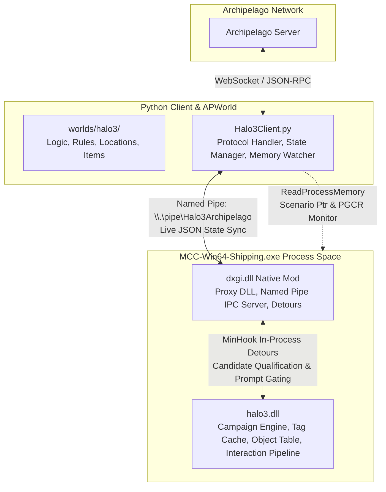
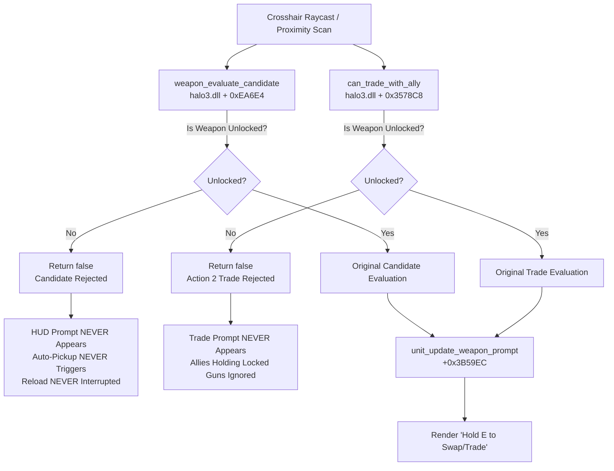

# Halo 3 Archipelago Architecture & IPC Protocol

This document provides a comprehensive technical overview of the architecture connecting the **Archipelago MultiWorld** ecosystem to **Halo 3** running inside *Halo: The Master Chief Collection* (MCC).

---

## 1. System Overview

The integration spans three core components communicating across process and network boundaries:



### Component Roles

1. **Archipelago World Definition (`worlds/halo3/`)**:
   - Implements `Halo3World(World)` for seed generation.
   - Defines items (Mission Unlocks, Weapon Licenses, Equipment, Traps), locations (Mission Completions, Collectibles), YAML options, and progression logic graphs.

2. **Archipelago Client (`Halo3Client.py`)**:
   - Connects to the Archipelago server via WebSockets (`CommonContext`).
   - Receives items, tracks received item indices, and reconciles state upon reconnection.
   - Pushes live inventory/unlocked state to the native mod over a local Windows Named Pipe.
   - Monitors MCC memory (`ReadProcessMemory`) for level transitions and Post-Game Carnage Reports (PGCR) to dispatch location checks automatically.

3. **Native MCC Mod (`mcc_mod/dxgi.dll`)**:
   - Loads into `MCC-Win64-Shipping.exe` at startup via DXGI proxying.
   - Runs a multithreaded Named Pipe IPC server (`\\.\pipe\Halo3Archipelago`).
   - Hooks campaign lobby functions to prevent starting locked levels in the menus.
   - Dynamically discovers `halo3.dll` when campaign missions load and installs hooks into Halo 3's native interaction qualification pipeline for real-time weapon and ally trading gating.
   - **Module structure:**
     - `hook_manager.cpp` — Slim orchestrator with data-driven hook table for install/remove lifecycle.
     - `engine/tag_system.cpp` — Tag instance resolution, O(1) weapon identification via Set 0xE StringIDs, dynamic tag scanning.
     - `engine/object_table.cpp` — Object datum resolution via TLS, player identification, inventory enforcement.
     - `hooks/lobby_hooks.cpp` — MCC CampaignLobby::StartCountdown interception for mission gating.
     - `hooks/weapon_hooks.cpp` — All weapon interaction detours (candidate evaluation, prompt suppression, pickup/swap/trade gating).
     - `hooks/engine_hooks.cpp` — Halo 3 simulation tick and MCC dispatch hooks.
     - `hooks/event_hooks.cpp` — Rally point, terminal, and skull detection hooks. Fires events consumed by client via IPC.
     - `memory_utils.h` — Shared `IsValidRead` pointer validation and `LOG_ONCE_PER_DATUM` macro.

---

## 2. Named Pipe IPC Protocol

State synchronization between `Halo3Client.py` and `dxgi.dll` uses a high-performance Windows Named Pipe:

* **Pipe Name**: `\\.\pipe\Halo3Archipelago`
* **Transport**: Full-duplex byte stream, text-mode UTF-8.
* **Message Framing**: Newline-delimited JSON (`\n`). Each request receives a single JSON response line.
* **Thread Safety**: State writes and reads in `dxgi.dll` are protected by a `std::mutex` (`g_modState.mtx`).

### Protocol Specification

#### 1. `get_state`
Queries the native mod's current internal state.
* **Direction**: Client &rarr; Native Mod
* **Request**:
  ```json
  {"cmd": "get_state"}
  ```
* **Response**:
  ```json
  {
    "status": "ok",
    "unlocked_missions": ["Sierra 117", "Crow's Nest"],
    "unlocked_weapons": ["assault_rifle", "needler", "spiker"],
    "starting_weapon": "assault_rifle",
    "weapon_mode": 1
  }
  ```

#### 2. `set_unlocked_missions`
Updates the list of authorized campaign missions.
* **Direction**: Client &rarr; Native Mod
* **Request**:
  ```json
  {
    "cmd": "set_unlocked_missions",
    "missions": ["Sierra 117", "Crow's Nest", "The Storm"]
  }
  ```
* **Response**:
  ```json
  {"status": "ok", "message": "unlocked missions updated"}
  ```

#### 3. `set_unlocked_weapons`
Updates the list of licensed weapons.
* **Direction**: Client &rarr; Native Mod
* **Request**:
  ```json
  {
    "cmd": "set_unlocked_weapons",
    "weapons": ["assault_rifle", "needler", "spiker", "plasma_pistol"]
  }
  ```
* **Response**:
  ```json
  {"status": "ok", "message": "unlocked weapons updated"}
  ```

#### 4. `set_starting_weapon`
Configures the default starter weapon granted if the player would otherwise be unarmed.
* **Direction**: Client &rarr; Native Mod
* **Request**:
  ```json
  {
    "cmd": "set_starting_weapon",
    "weapon": "assault_rifle"
  }
  ```
* **Response**:
  ```json
  {"status": "ok", "message": "starting weapon updated"}
  ```

#### 5. `set_weapon_mode`
Configures the active weapon licensing mode.
* **Direction**: Client &rarr; Native Mod
* **Request**:
  ```json
  {
    "cmd": "set_weapon_mode",
    "mode": 1
  }
  ```
  *(Mode values: `0` = Disabled/Vanilla, `1` = Individual Licenses, `2` = Weapon Tiers)*
* **Response**:
  ```json
  {"status": "ok", "message": "weapon mode updated"}
  ```

#### 6. Continuous State Sync & Event Delivery
To ensure zero latency for in-game event detection, `Halo3Client.py` synchronizes state and polls the pipe server at 500ms intervals inside `mcc_watcher`.
* **Direction**: Client &harr; Native Mod
* **Client Request**:
  ```json
  {
    "unlocked_missions": ["Sierra 117"],
    "unlocked_weapons": ["assault_rifle"],
    "weapon_license_mode": 1,
    "starting_weapon": "assault_rifle"
  }
  ```
* **Native Mod Response**:
  ```json
  {
    "status": "ok",
    "events": [
      "rally_1:010_jungle",
      "skull_secondary_0:010_jungle",
      "game_won:010_jungle"
    ]
  }
  ```
  *(Event keys include the active scenario code resolved from `MCC_SCENARIO_STRUCT` (`mccBase + 0x03F8E778 -> +0x30`) to guarantee deterministic location attribution regardless of level transitions).*

---

## 3. MCC Menu & Level Gating Lifecycle

To prevent players from entering locked missions from the MCC campaign menu:

1. **Proxy Loading**:
   - `MCC-Win64-Shipping.exe` loads `dxgi.dll` from its `mcc/binaries/win64/` directory.
   - The proxy forwards genuine DirectX 11/12 calls to the system `C:\Windows\System32\dxgi.dll`.

2. **Lobby Interception**:
   - When the player selects a mission and clicks "Start Game", MCC initiates countdown logic (`CampaignLobby::TryStartMatch` / `LaunchMission`).
   - `dxgi.dll` inspects the selected scenario's chapter token (e.g. `$H3_Chapter_3-1_Title` &rarr; `010_jungle` &rarr; `Sierra 117`).
   - If the mission is not present in `unlockedMissions`:
     - The detour returns immediately without invoking the original engine function.
     - The countdown never begins, and no game session is initialized.
     - The player remains in the menu with complete navigation freedom (can select a different level, choose rally points, or back out).

---

## 4. Halo 3 In-Engine Interaction Pipeline & Weapon Gating

Early prototypes attempted post-pickup inventory stripping (`unit_add_weapon`), but this caused severe UX flaws: HUD prompts still appeared ("Hold [E] to swap"), button presses dropped held weapons onto locked items, and reload animations were repeatedly aborted by ground auto-pickup loops.

The current architecture hooks the **native qualification phase** of Halo 3's interaction pipeline inside `halo3.dll`. For disassembly, decompilation workflows, and tool instructions using Ghidra, see [reverse_engineering_notes.md §6](reverse_engineering_notes.md#6-reverse-engineering-with-ghidra).



### Hook Architecture & Responsibilities

| Hook Address | Engine Function | Responsibility in Archipelago Mod |
|:---|:---|:---|
| `halo3.dll + 0xEA6E4` | `weapon_evaluate_candidate` | **Master ground weapon candidate evaluator.** Returning `false` prevents the weapon from ever registering as an interaction candidate. HUD swap/pickup prompts never render, and pressing/holding [E] ignores the weapon. |
| `halo3.dll + 0x3578C8` | `can_trade_with_ally` | **Ally trade candidate evaluator (`Action 2`).** Parameters: `(unitDatum, weaponDatum)`. Returning `false` when the weapon is locked completely suppresses "Hold [E] to trade weapons" prompts for Marines/allies holding locked guns. |
| `halo3.dll + 0x35887C` | `unit_can_pickup_weapon` | **Universal weapon interactability gate.** Evaluates candidate suitability during crosshair raycasts, crate inspections (`+0x0EAB47`), and inventory queries. Locked weapons are rejected, while secondary slot verification during swaps (`+0x0EAD0F`) passes through safely. |
| `halo3.dll + 0x3B2F18` | `unit_action_pickup_weapon` | **Proximity auto-pickup action handler.** Suppresses auto-pickup for locked weapons so Chief can stand on ground weapons and reload cleanly without animation interruption. |
| `halo3.dll + 0x3B2DAC` | `unit_action_swap_weapon` | **Manual weapon swap action handler.** Monitors button-hold weapon swaps and ensures atomic exchange. |
| `halo3.dll + 0x358024` | `unit_add_weapon` | **Final inventory addition gate.** Blocks script-based or cutscene additions of locked weapons while preserving the unarmed safety net. |
| `halo3.dll + 0xB2538` | `Halo3EngineStep` | **Per-tick simulation hook.** Triggers dynamic tag table scan on first tick of each new level and runs `CheckAndEnforcePlayerInventory` to strip locked weapons and enforce the unarmed safety net. |
| `halo3.dll + 0xF0810` | `game_insertion_point_unlock` | **Rally point unlock detection.** Parameter: `rallyIndex` in `ecx` (`1` = Bravo, `2` = Charlie). Generates `rally_N:<scenario>` event strings. |
| `halo3.dll + 0x3A8798` | `terminal_activate` | **Terminal detection.** Native engine function invoked when player activates/reads a terminal device. Generates `terminal_N:<scenario>` events with fallback bitfield polling in `Halo3EngineStep`. |
| `halo3.dll + 0x136088` | `campaign_metagame_award_primary_skull` | **Primary skull pickup detection.** Parameters: `(playerDatum in ecx, skullIndex in edx)`. Detects Iron, Black Eye, Tough Luck, Catch, Fog, Famine, Thunderstorm, Tilt, and Mythic skulls. Generates `skull_primary_N:<scenario>` events. |
| `halo3.dll + 0x136580` | `campaign_metagame_award_secondary_skull` | **Secondary skull pickup detection.** Parameters: `(playerDatum in ecx, skullIndex in edx)`. Detects Blind, Cowbell, IWHBYD, and Grunt Birthday Party skulls. Generates `skull_secondary_N:<scenario>` events. |
| `halo3.dll + 0x1F2F7C` | `game_won` | **Mission victory detection.** HS evaluator invoked upon campaign mission completion. Generates `game_won:<scenario>` event. |
| `halo3.dll + 0xF05A3` | *Level Advance Branch Patch* | **Next mission bypass.** Byte patch changing `jne +0x2A` (`75 2A`) to `jmp +0x2A` (`EB 2A`). Skips `LoadNextCampaignLevel` (`+0x1398E4`) in the `game_won` handler and branches straight to session conclusion (`+0xF05CF`). |
| `halo3.dll + 0x12EBC4` | `main_game_load_next_level` | **Next mission fallback guard.** Patched with `xor al, al; ret` (`30 C0 C3`) so returning `false` triggers the engine's natural fallback logic at `+0x12E619`, transitioning `halo3.dll` safely into an idle state. |
| `MCC + 0x1E6424` | `RestartGameEngine` | **Menu transition interceptor.** When `WasGameWonFired()` is active, zeroes the queued scenario string in `MCC_SCENARIO_STRUCT` (`+0x3F8E778`) and delegates to the original handler with unmodified arguments to cleanly return to the MCC lobby. |

---

## 5. Universal O(1) Tag Identification (Set 0xE StringIDs)

A major hurdle in MCC modding is that tag indices vary across campaign maps (e.g. Needler is tag `0x0E87` on `010_jungle.map`, but a completely different index on `020_base.map`). 

Halo 3 solves this internally via its **Switch-To StringID** compiled into every weapon tag definition at offset `+0x11C`. These StringIDs belong to **Set 0xE** (global engine strings compiled into `halo3.dll`) and are **100% constant across every single map in the game**:

```
Tag Datum (0x????xxxx)
  │
  ├──> Index = datum & 0xFFFF
  ├──> halo3.dll + 0xA49018 (tag_instances) + index * 8 + 4  ──> tagOffsetDword
  └──> halo3.dll + 0x1FCF4C8 (tag_cache_base) + tagOffsetDword * 4  ──> tagDef Address
                                                                          │
                                                                   tagDef + 0x11C (s11c)
                                                                          │
                                                                          ▼
                                                         Switch-To StringID (Set 0xE)
```

### Verified Set 0xE Switch-To StringID Table

| StringID (`s11c`) | Canonical Weapon Key | Weapon Name / Description |
|:---|:---|:---|
| `0xE112` | `assault_rifle` | MA5C Individual Combat Weapon System |
| `0xE113` | `smg` | M7/Caseless Submachine Gun |
| `0xE114` | `covenant_carbine` | Type-51 Carbine |
| `0xE116` | `battle_rifle` | BR55HB Service Rifle |
| `0xE117` | `beam_rifle` | Type-50 Particle Beam Rifle |
| `0xE119` | `rocket_launcher` | M41 Surface-to-Surface Rocket Medium Anti-Vehicle |
| `0xE11A` | `machinegun_turret` | Detachable AIE-486H Heavy Machine Gun |
| `0xE11D` | `sentinel_beam` | Sentinel Beam (Major variant) |
| `0xE11F` | `flak_cannon` | Type-52 Pistol (Fuel Rod Gun) |
| `0xE120` | `flamethrower` | M7057 Defoliant Projector |
| `0xE122` | `shotgun` | M90A Close Quarters Weapon System |
| `0xE123` | `magnum` | M6G Personal Defense Weapon System |
| `0xE124` | `missile_pod` | LAU-65D/SGM-151 Missile Pod |
| `0xE125` | `needler` | Type-33 Guided Munitions Launcher |
| `0xE126` | `gravity_hammer` | Type-2 Energy Weapon/Hammer |
| `0xE129` | `plasma_pistol` | Type-25 Directed Energy Pistol |
| `0xE12A` | `plasma_rifle` | Type-25 Directed Energy Rifle |
| `0xE12B` | `sniper_rifle` | SRS99D-S2 AM Sniper Rifle |
| `0xE12C` | `mauler` | Type-52 Pistol |
| `0xE12D` | `plasma_cannon` | Detachable Type-52 Plasma Cannon |
| `0xE12E` | `sentinel_beam` | Standard Aggressor Sentinel Beam |
| `0xE12F` | `brute_shot` | Type-25 Grenade Launcher |
| `0xE130` | `spartan_laser` | Weapon/Anti-Vehicle Model 6 Grindell/Galilean Non-Linear Rifle |
| `0xE131` | `energy_sword` | Type-1 Energy Weapon/Sword |
| `0xE132` | `spiker` | Type-25 Carbine |

*Lookup Performance*: O(1) direct switch statement with zero dynamic string allocations and zero lock contention.

### Skull & Oddball StringID Collision Resolution
In Halo 3 tag definitions (`weap`), campaign skulls (`primary_skull.weapon`, `secondary_skull.weapon`) and the multiplayer oddball share the Switch-To StringID `0xE113` with the SMG.

If unhandled, dynamic tag scanning registers both skulls as `"smg"`. When SMG is locked in an Archipelago seed, the mod's weapon interaction hooks (`weapon_evaluate_candidate`, `unit_can_pickup_weapon`, `unit_action_pickup_weapon`) treat skulls as locked SMGs, suppressing HUD pickup prompts ("Hold [E] to pick up skull") and auto-pickup.

To differentiate skulls and oddballs from the SMG:
* **Weapon Type (`tagDef + 0x18C`, uint16_t)**: Set to `11` (`_weapon_type_ball`) for skulls and oddball, whereas firearms have values `!= 11` (e.g. 0).

In `ScanAndRegisterMapWeapons`, tags with `weaponType == 11` are skipped during dynamic weapon registration. In `IsTagUnlocked`, tags with `weaponType == 11` return `true` unconditionally, ensuring skulls can always be picked up regardless of weapon licensing state.

---

## 6. Campaign Mission Auto-Detection & Clean Menu Return

Campaign completion and level transition prevention use coordinated detours across both `halo3.dll` and `MCC-Win64-Shipping.exe`:

### Pathway 1: Mission Completion & Auto-Exit via MCC `RestartGameEngine` (+0x1E6424)
When a campaign level is beaten:
1. Halo 3 fires `game_won` (`halo3.dll + 0x1F2F7C`), which emits the `game_won:<scenario>` event across IPC to `Halo3Client.py`.
2. When MCC receives match completion, it attempts to advance the playlist by invoking `MCC-Win64-Shipping.exe + 0x1E6424` (`RestartGameEngine`).
3. `Detour_RestartGameEngine` intercepts this call, clears the queued scenario string at `MCC_SCENARIO_STRUCT` (`mccBase + 0x03F8E778 -> +0x30`), and suppresses execution of the original function.
4. MCC cleanly halts campaign playlist progression and returns the player to the PGCR / main menu without automated UI clicks or synthetic keystrokes.

### Pathway 2: Post-Game Carnage Report (PGCR) Detection (Fallback)
If the player finishes a level and returns to the menu or game summary screen:
- PGCR flag: `MCC-Win64-Shipping.exe + 0x4000B8C + 0xC`.
- When the flag transitions to `1`, the client detects completion, logs the victory, and dispatches the corresponding check.

---

## 7. Memory Safety & Robustness Guarantees

Because Halo 3 dynamically loads, allocates, and frees entities across simulation and rendering threads, all pointer dereferencing in `dxgi.dll` follows strict safety rules:

1. **`IsValidRead` Pointer Validation** (defined in `memory_utils.h`):
   ```cpp
   // memory_utils.h — shared inline used by all engine and hook modules
   namespace Halo3AP {
       inline bool IsValidRead(const void* p, size_t size) {
           uintptr_t v = (uintptr_t)p;
           return (v > 0x10000 && v < 0x00007FFFFFFFFFFFULL && (v + size) > v);
       }
   }
   ```
   Every object pointer resolved via `GetObjectPtr` is checked against valid user-mode 64-bit address space before any member offsets or tag datums are read.

2. **TLS Thread Fallback**:
   Object table resolution uses Halo 3's thread-local storage (`gs:[0x58] + tlsIndex*8 + 0x38 -> +0x48`). If called from a non-simulation thread (such as the HUD rendering pass), it gracefully falls back to `g_cachedObjectTableData` captured during the last simulation step.

3. **Clean Module Lifecycle**:
   A dedicated background thread monitors `halo3.dll`. When the game unloads a map and frees `halo3.dll`, all hooks are cleanly disabled and uninstalled via `RemoveHalo3Hooks()` before the module memory is unmapped, preventing access violation crashes on engine transitions.
